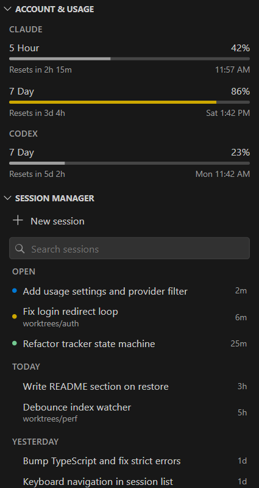

# OMP Session Manager

A VS Code sidebar for [Oh My Pi](https://github.com/can1357/oh-my-pi) (`omp`), the terminal coding agent.



- **Usage limits.** Shows the output of `omp usage` per provider, with a countdown and the local reset time. Optional status bar item and a warning when a limit gets close.
- **Session history.** Lists your omp sessions for the current workspace, or all of them, grouped by date or folder. Groups collapse, and a folder group's `+` starts a new session there. Click a session to resume it in a terminal.
- **Live status.** Each open session shows whether it is idle, working, or waiting on your answer. Notifies you, in VS Code or through the OS, when a background session finishes or asks a question.
- **Restore on startup.** Reopens the omp sessions that were open when VS Code closed, in the same tab order. Can ask first.
- **Context menu.** Open in editor or panel, copy the session id or file path, reveal the session file, delete a closed session.
- **Launch requests.** Another program on the same machine, such as [omp-remote](https://github.com/MYSTRAVIL/omp-remote), can start omp in the window that has the project open, or in a new window.
- **Focus requests.** Another program on the same machine, such as a dashboard of your sessions, can bring a session's terminal to the front: the window that runs it shows the terminal and raises itself.

## Requirements

- VS Code 1.90 or later.
- `omp` on your `PATH`, or its absolute path in `omp.executable`.

## Install

Search for **OMP Session Manager** in the Extensions view, or install it from the [Visual Studio Marketplace](https://marketplace.visualstudio.com/items?itemName=mystravil.omp-manager).

Each [GitHub release](https://github.com/MYSTRAVIL/vscode-omp-manager/releases) also has the `.vsix`. Install it with `code --install-extension omp-manager-<version>.vsix`.

## How it works

The extension launches every omp with `-e <extension>/out/hook/vscode-session-restore.js`. That omp extension, built on [omp-session-core](https://github.com/MYSTRAVIL/omp-session-core), writes a small record to `<agentDir>/vscode-terminals/` when a session starts or switches, and when the agent starts working, stops, asks a question, waits on a tool approval, or opens a plan review. The sidebar reads those records to map terminals to sessions and to show status.

To get status and restore for omp started by hand in a VS Code shell terminal, copy `out/hook/vscode-session-restore.js` from the extension's folder (`~/.vscode/extensions/mystravil.omp-manager-<version>/`) into your omp extensions directory (`~/.omp/agent/extensions/`). Copy it again after you update the extension. Loading it twice is harmless.

Tab titles come from omp itself. Set `terminal.integrated.tabs.title` to include `${sequence}` to see them; the default shows only `omp`.

The `OMP` output channel logs each launch with timings: terminal created, process started, and omp's first report. Check it when a session is slow to open.

## Launch requests

Another program on the same machine (the requester) can ask VS Code to start omp in a project folder. omp-remote uses this to open sessions started on the phone. Every local window takes part; remote windows (SSH, WSL, containers) do not.

All files live in the omp agent directory (`omp.agentDir`, else `PI_CODING_AGENT_DIR`, else `~/.omp/agent`). Every JSON write is atomic: write `<name>.<pid>.tmp`, then rename it. Readers ignore other names.

| File | Written by | Purpose |
| --- | --- | --- |
| `vscode-launch-handler.json` | this extension, in every local window on activation | Says a handler is installed, how to open a new window, and which focus requests it takes |
| `vscode-launch/<id>.json` | the requester | One launch request |
| `vscode-launch/<id>.claim` | whoever takes the request | Exclusive lock |

The handler file:

```json
{
  "v": 1,
  "extension": "mystravil.omp-manager",
  "version": "0.5.0",
  "launcher": "C:\\Users\\me\\AppData\\Local\\Programs\\Microsoft VS Code\\Code.exe",
  "focusRequests": 1,
  "updatedAt": 1794700000000
}
```

Run `<launcher> --new-window <folder>` directly, with no shell, to open a folder in a new window of the same VS Code install. On Windows `launcher` is the GUI executable, never `bin\code.cmd`, because cmd.exe would parse the folder path. Elsewhere it is the install's `bin/code` script.

`focusRequests` is the version of [focus request](#focus-requests) this extension takes. Handlers older than 0.5.0 leave the field out.

A request:

```json
{
  "v": 1,
  "id": "5b0c9e1e-7f0a-4d3c-9a43-0d2f6c1b8e77",
  "requester": "omp-remote",
  "cwd": "C:\\Users\\me\\Projects\\app",
  "args": ["--model", "anthropic/claude-sonnet-5"],
  "env": { "OMP_REMOTE_SPAWN_ID": "k3j" },
  "newWindow": false,
  "createdAt": 1794700000000,
  "expiresAt": 1794700001500
}
```

`id` matches `^[A-Za-z0-9-]{8,64}$` and equals the file name. `args` are omp arguments without the executable. `env` is added to the terminal's environment. `newWindow` is `true` only when the requester opened a new window for this request.

A window takes a request when it is valid, has not reached `expiresAt`, has no claim yet, and its `cwd` is exactly one of the window's folders. A parent or child folder does not count; paths compare case-insensitively on Windows. The window takes it by creating `<id>.claim` exclusively, with `{ "by": "omp-manager", "pid": <number>, "at": <ms> }`, then starts omp:

- arguments: `-e <hook>`, then the request's `args`. `omp.extraArgs` is skipped, so its `--model` cannot override the request's.
- environment: `omp.env`, then the request's `env`.
- location: `omp.terminalLocation`, focused, because VS Code starts no process for an editor terminal until its tab is laid out.

The window leaves the request and the claim in place; the requester deletes them. Activation deletes requests that expired over an hour ago with their claims, and leftover claims and `.tmp` files of that age.

When no window claims a request in time, the requester can claim it itself, run the launcher for `cwd`, and write a second request with `newWindow: true` for the new window to claim. That window is marked as opened for a launch request. A window that was already open is never marked, and a reload forgets the mark. When the last omp terminal in a marked window closes, the window closes too, unless `omp.closeLaunchedWindow` is off. VS Code still asks about unsaved files. A session that exits with an error keeps its tab, so the window stays until you close that tab.

## Focus requests

Another program on the same machine (the requester) can ask VS Code to bring the terminal of an omp session to the front, for example when you double-click that session in a dashboard. Every local window takes part; remote windows do not. The files sit beside the launch request files and are written the same way.

| File | Written by | Purpose |
| --- | --- | --- |
| `vscode-focus/<id>.json` | the requester | One focus request |
| `vscode-focus/<id>.claim` | the window that takes the request | Exclusive lock |

A requester asks only when the handler file has `"focusRequests": 1` and a record in `<agentDir>/vscode-terminals/` (see [How it works](#how-it-works)) has the session's `sessionId` or `pid`. That record means the session runs in a VS Code terminal.

A request:

```json
{
  "v": 1,
  "id": "c1b8e775-b0c9-4e1e-8f0a-4d3c9a430d2f",
  "requester": "my-dashboard",
  "sessionId": "01a1a08a-9539-7185-8d1d-27be486a41d9",
  "pid": 12345,
  "createdAt": 1794700000000,
  "expiresAt": 1794700002000
}
```

`id` matches `^[A-Za-z0-9-]{8,64}$` and equals the file name. `sessionId` is the omp session id and `pid` is the id of the omp process that runs it.

A window takes a request when it is valid, has not reached `expiresAt`, has no claim yet, and has an open omp terminal whose session id is `sessionId` or whose omp process id is `pid`. It takes it by creating `<id>.claim` exclusively, with the same content as for a launch request, then shows that terminal and gives it the keyboard focus.

A window that does not have the operating system's focus also raises itself. It runs the handler file's `launcher` with its workspace as the only argument, detached and with no shell: the saved `.code-workspace` file, else the first local folder. Asked to open a workspace that a window already has open, VS Code brings that window to the front and restores it when minimized. `window.openFoldersInNewWindow` does not change that, because VS Code looks for an open window before it consults the setting. A window with no workspace on disk, an empty window or one with an untitled workspace, cannot raise itself. It still shows the terminal.

The requester deletes the request and the claim once it sees the claim, or once the request has expired. No claim means that no open window runs the session: its terminal is not in VS Code, or its window has not restarted its extension host since the extension was updated.

Windows lets a process take the foreground only after the user's input, or after a process that has it allows another. Otherwise VS Code flashes the taskbar button instead of raising the window. A requester that the user has just clicked can call `AllowSetForegroundWindow(ASFW_ANY)` before it writes the request.

The launcher finds the running VS Code through its default user data directory, or the `data` folder of a portable install. A VS Code started with its own `--user-data-dir` cannot be raised this way: the launcher would reach the default instance instead.

Activation deletes requests that expired over an hour ago with their claims, and leftover claims and `.tmp` files of that age.

## Keybindings

| Keys | Command |
| --- | --- |
| `Ctrl+Alt+O` `N` | New Session |
| `Ctrl+Alt+O` `R` | Resume Session |
| `Ctrl+Alt+O` `W` | Focus Next Session Needing Input |

On macOS, use `Cmd` instead of `Ctrl`.

## Settings

### Launch

| Setting | Default | Description |
| --- | --- | --- |
| `omp.executable` | `omp` | omp executable name or absolute path. |
| `omp.agentDir` | empty | omp agent directory. Empty uses `PI_CODING_AGENT_DIR`, then `~/.omp/agent`. |
| `omp.extraArgs` | `[]` | Extra arguments for every omp the extension launches, for example `["--model", "sonnet"]`. |
| `omp.env` | `{}` | Extra environment variables for every omp the extension launches. |
| `omp.newSessionCwd` | `workspaceRoot` | Where New Session starts: `workspaceRoot`, `activeFileFolder`, or `ask`. |
| `omp.terminalLocation` | `editor` | Open sessions in the `editor` area or the `panel`. VS Code starts an editor terminal only once its tab is laid out, so it can appear a moment later than a panel one. |
| `omp.terminalIcon` | `sparkle` | Codicon id for omp terminal tabs. |
| `omp.terminalColor` | empty | Theme color id for omp terminal tabs, for example `terminal.ansiMagenta`. |
| `omp.restoreOnStartup` | `always` | Reopen the sessions that were open when VS Code closed: `always`, `ask`, or `never`. |
| `omp.restoreContinuesTurns` | `false` | Restore with `omp --restore` instead of `--resume`, so a turn that VS Code closing or crashing cut off goes on, with its subagents. Needs omp 18.10.3 or later. |
| `omp.focusOnStartup` | `true` | Open the OMP sidebar at startup instead of the last active view, such as Explorer. |
| `omp.closeLaunchedWindow` | `true` | Close a window that was opened for a [launch request](#launch-requests), such as a session started on the phone through omp-remote, when its last omp session ends. Other windows never close. |

### Usage

| Setting | Default | Description |
| --- | --- | --- |
| `omp.usage.refreshMinutes` | `5` | Refresh interval while the sidebar or status bar item shows usage. |
| `omp.usage.warnPercent` | `80` | Percent at which a meter turns to the warning color. |
| `omp.usage.providers` | `[]` | Providers to show. Empty shows all. |
| `omp.usage.resetDisplay` | `both` | Show the reset as a `countdown`, the local `time`, or `both`. |
| `omp.usage.showPace` | `true` | Mark the even-pace point on each meter and show how far under or over pace usage is. |
| `omp.usage.statusBar` | `false` | Show the most-used limit in the status bar. |
| `omp.usage.notifyOnWarn` | `true` | Notify once per reset window when a limit reaches the warn percent. |

### Sessions

| Setting | Default | Description |
| --- | --- | --- |
| `omp.sessions.scope` | `workspace` | List sessions from the open workspace, or `all`. The workspace includes the same folders in other git worktrees of their repositories, as omp's resume picker does. |
| `omp.sessions.maxShown` | `300` | Most sessions listed. Open sessions always show. |
| `omp.sessions.showEmpty` | `false` | List sessions that have no prompt yet. |
| `omp.sessions.sortBy` | `modified` | Sort newest first by `modified` or `created`. |
| `omp.sessions.groupBy` | `date` | Group the list by `date`, by `folder`, or not at all (`none`). Open sessions always come first. |

### Notifications

These are VS Code notifications from this extension, separate from omp's own.

| Setting | Default | Description |
| --- | --- | --- |
| `omp.notify.onFinish` | `true` | Notify when a session finishes while its tab is not in view. |
| `omp.notify.onInput` | `true` | Notify when a session asks a question while its tab is not in view. |
| `omp.notify.minWorkSeconds` | `10` | Skip the finish notification for runs shorter than this. |
| `omp.notify.style` | `vscode` | `vscode`, `system` (OS notification with sound while VS Code is in the background), or `both`. |

## Development

```sh
npm install
npm run watch   # compile on change; press F5 in VS Code to launch an Extension Development Host
npm test        # unit tests with a vscode stub
```

## Releasing

1. Add a `## <version>` section to `CHANGELOG.md`.
2. Run `npm version patch` (or `minor`, `major`). It bumps `package.json`, commits, and tags `v<version>`.
3. Run `git push --follow-tags`. The Release workflow tests, packages, and publishes a GitHub release with the `.vsix` and the changelog section as notes.
4. Download the `.vsix` from the release. On the publisher page, <https://marketplace.visualstudio.com/manage/publishers/MYSTRAVIL>, open the extension's **...** menu, choose **Update**, and upload it.

## License

[MIT](LICENSE)
